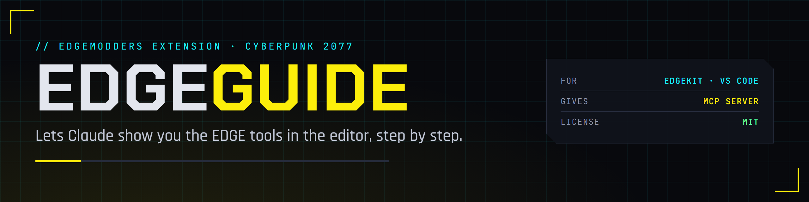

  

  
  
  
  
  

EDGEguide lets Claude show you how the EDGE tools work, in the editor itself. Ask "show me how to put my project into the game", and Claude opens REDcode's Project view, points at **Pack and Install**, runs it once you agree, then opens EDGEdeck with your mod selected and points at **Deploy**.

It is an editor extension with a local MCP server that [Claude Code](https://code.claude.com/docs/en/overview) connects to through [EDGEchat](https://github.com/Edgemodders/EDGEchat), the EDGE plugin. It works in [EDGEkit](https://github.com/Edgemodders/EDGEkit) and in VS Code.

**[Docs](https://edgemodders.github.io/EDGEguide/)** · [Design](https://edgemodders.github.io/EDGEguide/design.html) · [EDGEkit](https://github.com/Edgemodders/EDGEkit) · [EDGEchat](https://github.com/Edgemodders/EDGEchat)

> [!NOTE]
> **Status: G0, design.** Nothing is built yet. The design draft says what it will do and what the editor allows.

## License

MIT. See [LICENSE](LICENSE).

EDGEguide is not affiliated with Microsoft, Anthropic or CD PROJEKT RED. Visual Studio Code is a trademark of Microsoft. Claude and Claude Code are trademarks of Anthropic. Cyberpunk 2077 is a trademark of CD PROJEKT.
